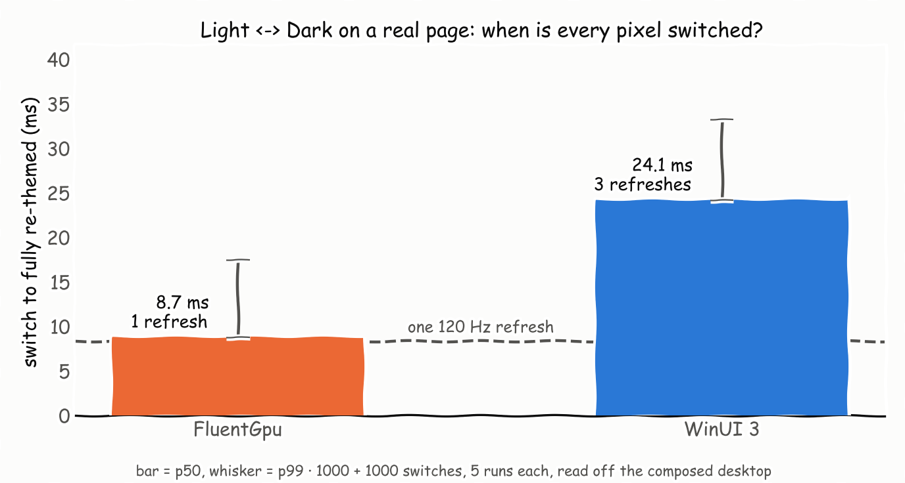
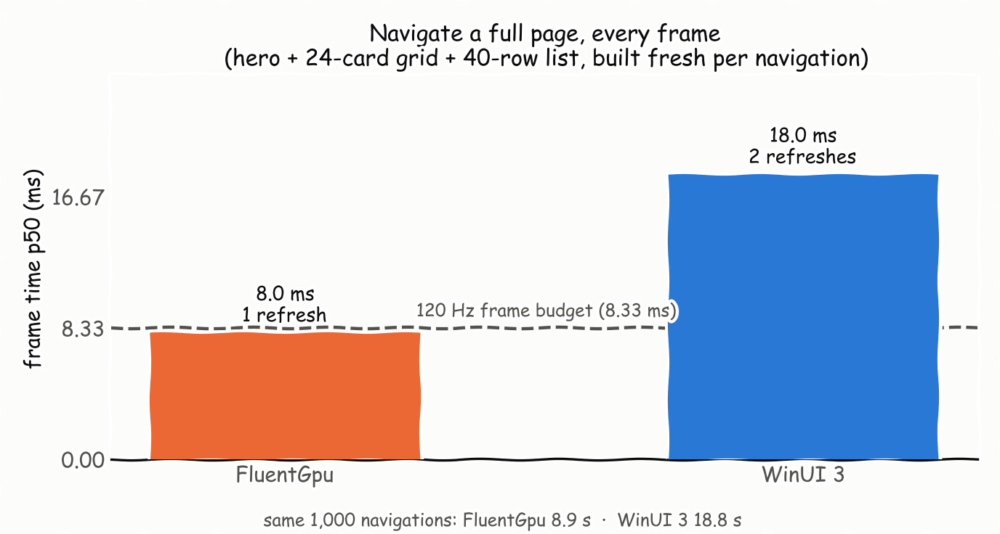
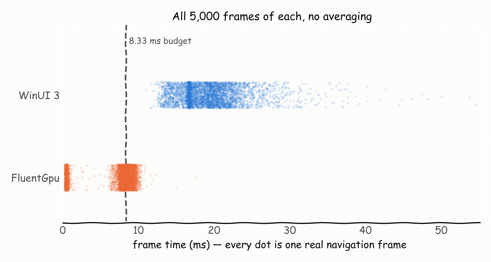
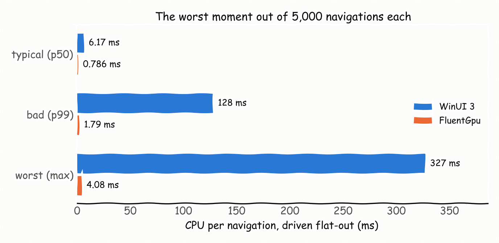
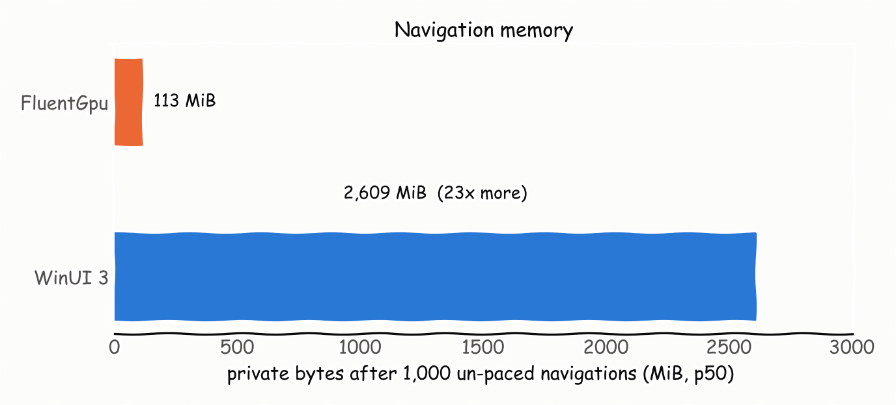
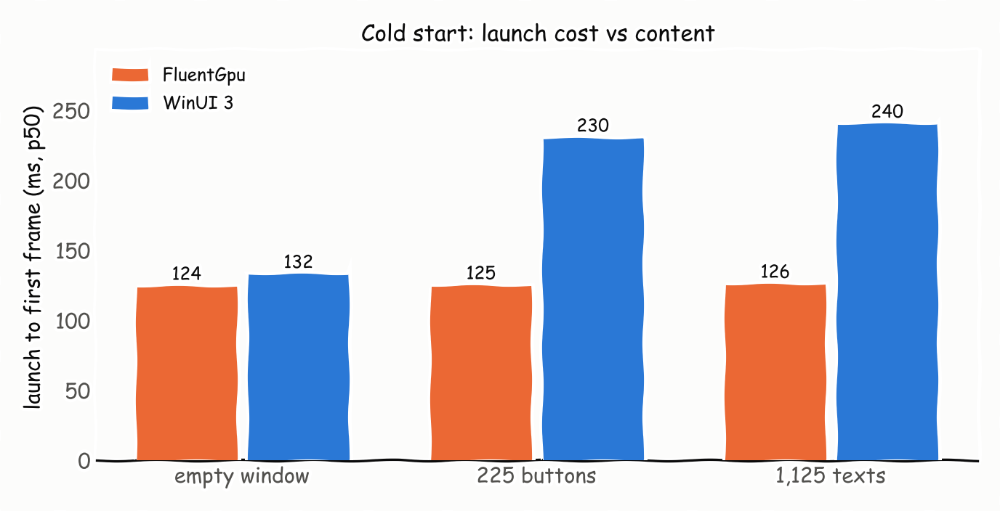
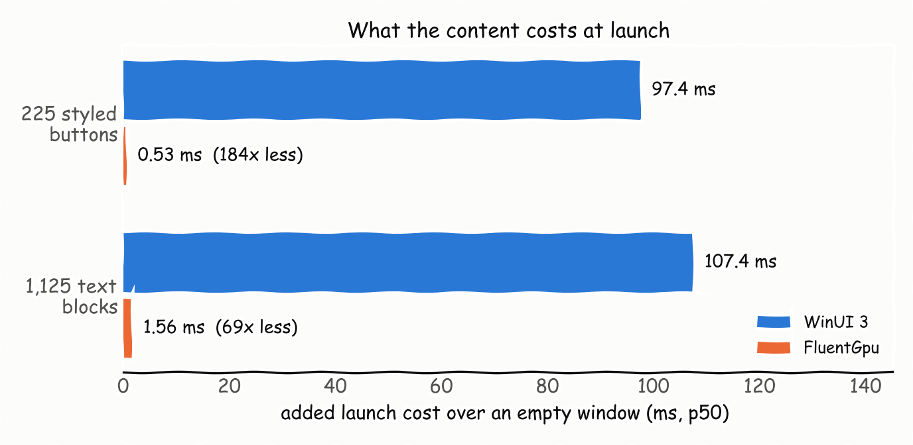
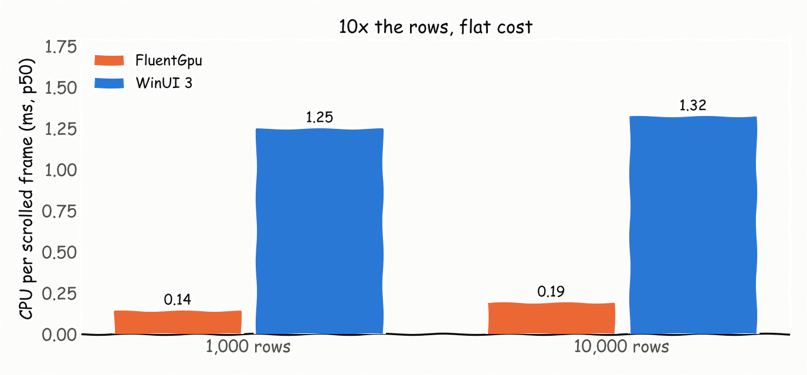
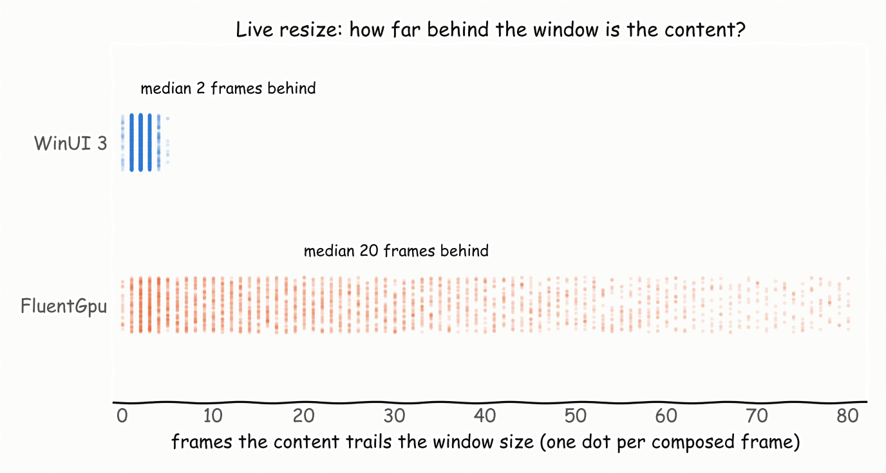

# FluentGPU vs WinUI 3 — same workloads, same machine, receipts included

Two ARM64 .NET 11 **NativeAOT** hosts render pixel-parity workloads — identical 1800×1080 client, identical
content, identical mutation per iteration — alternating launch order, every raw run retained, binaries
SHA-256-verified before every run. **339/340 runs completed** (2026-11-14): zero WinUI failures, one FluentGPU crash in
the new live-resize scenario, kept in the table (below, under "Where WinUI 3 wins").
Full numbers with every caveat: [RESULTS.md](RESULTS.md) · how it's measured: [METHODOLOGY.md](METHODOLOGY.md).

## Switch Light ↔ Dark: the whole page, on the next frame

Flip the theme on a real page (hero, 24 cards, 40-row list) and watch the composed desktop, frame by frame.
FluentGPU has every pixel in the new theme one refresh later; WinUI 3 takes three, every time.



| Switch → first fully re-themed frame (1,000 switches each) | WinUI 3 | FluentGPU | Gap |
|---|---:|---:|---:|
| p50 | 24.1 ms (3 refreshes) | **8.7 ms (1 refresh)** | **2.8×** |
| p99 / worst | 33.2 / 43.9 ms | **17.5 / 19.5 ms** | 1.9× / 2.3× |
| Half-themed frames | 0 | 0 | both switch atomically |

Measured off the desktop (DXGI desktop duplication of every composed frame, the same driver code in both hosts),
each framework switching its idiomatic way (`RequestedTheme` + `{ThemeResource}` styles vs FluentGPU tokens). FluentGPU's
default is a 250 ms cross-fade; this is its instant snap, the like-for-like of WinUI's instant switch.

## Navigate a real page: full frame rate vs half frame rate

FluentGPU builds and presents a complete page (hero + 24-card grid + 40-row list, fresh every navigation)
inside a single 120 Hz refresh. WinUI 3 needs more than two.



No averaging tricks — here is every individual frame from all five display-paced runs of each host:



| Per navigation (display-paced) | WinUI 3 | FluentGPU | Gap |
|---|---:|---:|---:|
| Frame time p50 | 18.0 ms | **8.0 ms** | **2.3×** |
| Frame time p99 / worst | 32.3 / 126 ms | **10.1 / 17.5 ms** | 3.2× / 7.2× |
| CPU p50 / p99 | 6.90 / 14.9 ms | **0.73 / 1.89 ms** | 9.5× / 7.9× |
| 1,000 navigations, wall clock | 18.8 s | **8.9 s** | 2.1× |

Driven flat-out (un-paced), WinUI's worst navigation hits **327 ms** and its p99 is 128 ms; FluentGPU's worst is
4.1 ms. WinUI's memory runs away; FluentGPU's doesn't move:





## Content is nearly free

Launch cost stays flat as the app grows — the *content* of a 225-button screen costs FluentGPU **0.53 ms**
on top of an empty window, 1,125 text blocks **1.6 ms**. WinUI pays 97 and 107 ms for the same screens.





## Steady-state work, display-paced

| Per-frame CPU p50 (cadence pass) | WinUI 3 | FluentGPU | Gap |
|---|---:|---:|---:|
| Scroll a 10,000-row virtualized list | 1.32 ms | **0.19 ms** | **7.0×** — and FluentGPU's span *includes* record + command-build + submit; WinUI's is mutation + layout only¹ |
| Scroll, 1,000 rows | 1.25 ms | **0.14 ms** | 9.0× |
| Swap a 499-node subtree | 2.72 ms | **0.73 ms** | **3.7×** |



Both frameworks hold vsync on trivial single-node mutations — that's the floor, and either engine clears it.
The gap opens exactly where apps actually spend their time: building, churning, scrolling and re-theming real content.

## Where WinUI 3 wins — printed just as large

| Category | WinUI 3 | FluentGPU |
|---|---:|---:|
| **Live window resize** (programmatic, one step per frame): content lag behind the window, p50 / p99 | **2 / 4 frames** | 20 / 78 frames (old frame shown stretched) |
| Live resize: resize step → content of that size, p50 | **29.5 ms** | 577 ms |
| Live resize: runs completed | **5/5** | 4/5 (one `ResizeBuffers` out-of-memory crash) |
| Idle memory floor (empty window) | **75 MiB WS / 38 MiB private** | 101 / 91 MiB |
| Steady-state memory while scrolling a list | **99 MiB WS / 53 MiB private** | 157-161 / 144-145 MiB |
| Frame-time p90/p99 on trivial mutations | **~8.55 / ~9.4 ms** | ~9.2 / ~9.8 ms (0.3-0.6 ms wider) |
| Cold-start tail, empty window (p99) | **182 ms** | 239 ms |



On live resize neither framework keeps content and window in the same frame, but WinUI stays two frames behind
(with an unpainted strip at the moving edge in 44 % of frames) while FluentGPU's per-step swapchain resize leaves it
~20 frames behind. FluentGPU's scroll memory grew since 2026-08-01 (110 → 144 MiB private); both are engine work items.

¹ The in-app CPU spans differ by construction (WinUI's compositor works off-thread, unmeasured here); the
frame-time rows are the like-for-like verdict. Carried as a caveat on every affected row in `summary.json`.
Managed allocation per navigation is now FluentGPU 71 KB vs WinUI 135 KB, but WinUI's XAML tree is largely native/COM
and invisible to `GC.GetAllocatedBytesForCurrentThread` — a counter-visibility caveat, not a win for either side.

Charts: matplotlib `plt.xkcd()`, generated by `scripts/make-readme-charts.py` from `results/2026-11-14-cpu` and
`results/2026-11-14-cadence` (schema v4); every number on a chart is read from those files. The 2026-08-01 dataset is
kept in RESULTS.md as superseded.

---

## Reproduce it

This is a standalone, application-free comparison (Wavee is not linked into either host). The runner alternates
launch order, retains every raw run, records non-zero exit codes, hashes the exact WinUI binary
(`Microsoft.WindowsAppSDK` 2.3.1, public stable), and archives the current FluentGPU engine patch. Generated
captures live under `results/` and are intentionally ignored by Git.

> **Schema break: results are `fluentgpu-framework-bench/v2`, summaries `fluentgpu-framework-bench-summary/v4`.**
> The measurement itself changed, not just the file shape: the cold-load start anchor moved to a module initializer
> on both hosts, WinUI's cold-load stop point moved to the second `CompositionTarget.Rendering` callback, the raw
> CPU pass runs one iteration per dispatcher callback, and the localized-transform mutation goes through the XAML
> property system instead of a composition `Visual.Offset`. **Older `results/` directories (v1/v3) are not
> comparable — never mix v3 and v4 numbers in the same table or claim.** (v2 results gained optional `metrics` /
> `series` fields for the desktop-driven scenarios; the shape is otherwise unchanged.)

Build the pinned public WinUI release baseline and both NativeAOT hosts (into `artifacts/framework-comparison/publish`):

```powershell
.\benchmarks\FrameworkComparison\scripts\build-release.ps1
```

Run a pass. The script runs one runner invocation per scenario (each writes `summary-<scenario>.json`) and then
`--aggregate`s them into `summary.json`; `-Wrap` puts a command prefix around each invocation, e.g. a machine-wide lock:

```powershell
.\benchmarks\FrameworkComparison\scripts\run-suite.ps1 -Pass cpu
.\benchmarks\FrameworkComparison\scripts\run-suite.ps1 -Pass cadence
```

`run-suite.ps1` verifies the release hashes written by `build-release.ps1` and archives that evidence beside every
summary. It deliberately refuses ad-hoc `bin/` hosts: those are useful diagnostics, not publishable comparisons. The
desktop-driven scenarios (`theme-switch`, `window-resize`) run on the cadence pass only and put the window topmost at
(32, 32); leave the machine alone while they run.

Capture mutation → desktop-visible latency with the frame-ID color probe (preferred cross-framework visibility metric):

```powershell
.\benchmarks\FrameworkComparison\scripts\capture-frame-id.ps1 `
  -Executable .\artifacts\framework-comparison\publish\FluentGpu\FluentGpuBench.exe `
  -Framework FluentGpu -Scenario virtual-scroll-10k `
  -OutputDirectory .\benchmarks\FrameworkComparison\results\frame-id
```

Capture displayed cadence / GPU busy / present intervals with PresentMon:

```powershell
.\benchmarks\FrameworkComparison\scripts\capture-presentmon.ps1 `
  -Executable .\artifacts\framework-comparison\publish\FluentGpu\FluentGpuBench.exe `
  -Framework FluentGpu -Scenario virtual-scroll-10k `
  -OutputDirectory .\benchmarks\FrameworkComparison\results\presentmon `
  -PacingTrace
```

`-PacingTrace` writes a FluentGPU-only JSONL trace beside the summary; it correlates each benchmark frame with the
publish/present-ack sequence, UI phase timings, and DXGI/DWM counters.

Use `capture-gpu-memory.ps1` for UMA-aware memory sampling and elevated `capture-wpr.ps1` for CPU, GPU,
ResidentSet, Heap, and WinUI XAML-provider traces. See [METHODOLOGY.md](METHODOLOGY.md) before interpreting ratios.
