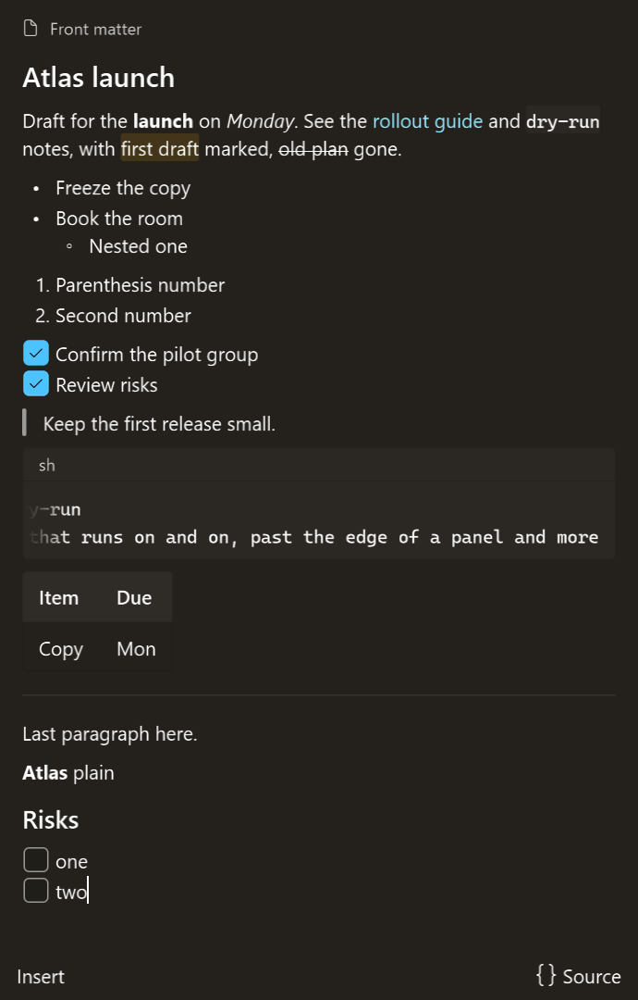
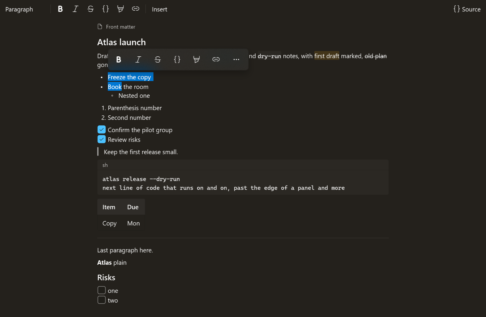
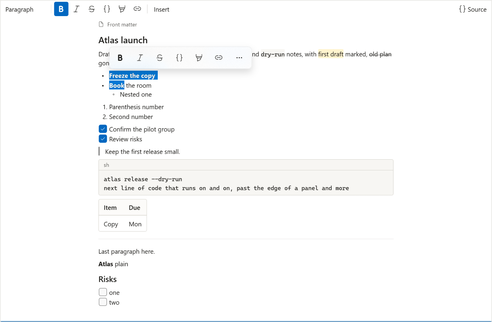

# FluentGpu: Subsystem Design: Markdown editor (`MarkdownEditor`)

> **Status, 2026-11-02: phase 1 is built, phase 2 is built apart from the image card and the paste hook, phases 3 to 5 are not
> started.** It runs on the engine and was driven through the real input queue, but no real IME and no real mouse has touched
> it. The owner decisions in section 8 are still open: the build follows the recommendations. Sections 2 to 7 are the design;
> section 0 says where the code stands against it.

## 0. What is built

Code: `src/FluentGpu.Controls/Markdown/Editor/` (`MarkdownEditModel`, `MarkdownProjection`, `MarkdownEditor`), the parser's
`ParseForEditor`, and the gallery page `MarkdownEditor` in `src/FluentGpu.WindowsApp/Pages/MarkdownPages.cs`.







| Area | State |
|---|---|
| Spike (section 7) | **Go.** One span flow with a caret and hidden markers, hit testing through the map, caret and selection across two flows all worked on the first real window. The IME part of the spike could not be run: it needs a person and a real IME. |
| Source buffer, one replace, undo | Built. `MarkdownEditModel.Apply` is the only place a byte changes, with Debug assertions on the bytes either side. |
| Parser | `ParseForEditor` gives start and end source offsets per text unit, delimiter ranges and list item markers. Tabs are expanded first and mapped back. `MarkdownExtensions.FrontMatter` is new, off for the viewer. Viewer parse unchanged. |
| Text, headings, lists, tasks, quotes, inline marks | Built. |
| Typed Markdown | Built. Opener with no closer dims while the caret's flow holds it. Ctrl+Z takes back the closer only. |
| Half-typed readings | A bare `#`, `-`, `1.`, `>` is text until its space arrives, and an unclosed fence is not a fence. This is the one place the editor reads differently from the viewer. `` ``` `` plus Enter writes the closer. |
| Shortcuts | Built: Ctrl+B, I, E, Shift+X, Shift+H, K, L, 0 to 6, `/`. Ctrl+U writes nothing and says why in the bar. The `/` chord is bound to the US key position (VK_OEM_2). |
| Selection across blocks | Built, one anchor and one caret. A selected paragraph break shows a tail. An object inside a longer selection shows no highlight of its own. |
| Selection flyout | Built on `CommandBarFlyoutBody`. Opens after a pointer selection or a right click, takes no focus, closes when the pointer moves away. |
| Source toggle | Built, `Ctrl+/`, same offsets, caret line anchored, short crossfade. Front matter is dimmed and has no caret stops. |
| Front matter (R5) | Built: a protected range, excluded from Ctrl+A. A quiet one-line note shows it, or `FrontMatterSlot`. |
| Tables, HTML, block images, nested code | Objects, selected whole. Enter, double click or Edit source opens a table's or HTML block's source in place, and leaving the block closes it. |
| Code blocks | Editable in place at the top level: one flow per line, panning. Inside a quote or list they are objects. Tab inserts the indent the note uses, Enter keeps the line's indent. |
| Insert menu | Built: `/` at the start of an empty line and the bar's Insert. The editor keeps focus while it filters. |
| Completion | Built: `MarkdownCompletionSource`. A consumer inline syntax is one caret stop, Backspace selects it first, and an alias is never rewritten. |
| Link card | Built: click for the card, Ctrl+click to follow, a reference link says where its address lives. |
| Paste | Built: one undo step in the note's newlines, a URL over a selection becomes a link. Copy closes a marker it cut through. |
| IME | Built as designed, driven only by calling the sink from a throwaway driver. **Not verified with a real IME.** |
| Image card, paste hook (`OnPasteContent`) | **Not built.** `IClipboard` is still text only. |
| Tables cell editing, virtualization, mid-note parse, UIA, reveal mode | **Not started** (phases 3 to 5). `MarkerReveal` is left out. |

### Differences from the proposal

- A bare `-` line under a paragraph still reads as a setext underline when typed directly below it, as CommonMark says. Enter leaves a blank line, so this takes typing it by hand.
- Pasted newlines become the note's dominant ending (R4 wins over "verbatim"). A note with no newline keeps what was pasted.
- An edit that makes or merges a block lands at once rather than easing: the split block eased while the new one was already there, and the note below bounced. The section 4 table has no row for this.
- The signal is written once per edit, not coalesced to idle. The full note is parsed per edit, with one component per top-level block so only the edited block re-renders.
- The Field chrome does not lighten on pointer over, unlike WinUI's RichEditBox: on a surface this large the owner read it as a smudge. Focused still uses `FocusedFill` and the accent bar.
- Source and code lines use Cascadia Mono, because Cascadia Code's ligatures draw `|---|` and `==` as other glyphs. Inline code keeps the style's face.

### What a screen reader gets

One focusable element with the text role and no name, no value, no text pattern. It does not get the note's words, the caret or the selection. Decision 6 is not funded. This is a real limit, not a detail.

### Measured

Debug build on an Adreno X1-85, through the real window. A Release build was not run, as the workspace rule says, so these overstate what a release costs.

| What | Result |
|---|---|
| Steady frames, focused with a caret and unfocused | 0 hot-phase bytes over 40 frames |
| Keystroke mid-note at 100 KB (2,093 flows), whole frame | 56 ms average, 77 ms worst. Parse and projection alone are about 32 ms. The 4 ms target is not met, and a mid-note parse window (phase 4) is what would close it. |
| Caret move | Moves no rect (read per frame). A caret move does no render. |
| `# ` converts | Blocks below ease to their new place, read per frame from the presented rects |
| Task toggle | One character, no rect moves |

### Round trip

A throwaway driver, kept out of the repo, ran 168 checks through the model on a deliberately untidy note: BOM, front matter, CRLF with a stray LF, `*` bullets, `1)` numbers, `__strong__`, setext headings, a reference link and definition, trailing spaces, extra blank lines, a tab, escapes and entities. Opening, arrowing through every stop and toggling the source changed no byte. Each of 21 commands changed only its own range, and undo returned the exact bytes. Through the real input queue, a session of typing, conversion, task toggles, cross-block bold, the source toggle, the link card and a table's source undid back to the identical file in dark and light, at 460 and 1100 wide.

### Not verified

- **IME:** no real IME has driven this. A simulated composition through the sink wrote nothing until commit and committed as one undo step.
- **Real mouse feel:** clicks, drags and double clicks came through the input queue, with the window disabled to the desktop.
- **Touch and pen:** not driven. A press captures for selection, so a touch drag selects rather than pans.
- **Clipboard:** not driven, to leave the owner's clipboard alone. `CopySelection` and `Paste` were checked on the model.
- **Not driven in a window:** Page Up and Down, the flyout's pointer-away close, flyout overflow rows, external signal writes (model only), reduced motion.
- **Other engines:** Typora, Obsidian and Notion were never opened, as section 9 says.

## 1. Design

Build `MarkdownEditor` as a **projection over the source text**. The buffer holds the file's exact characters, the
renderer conceals the markers, and every edit is one replace on that text. No tree is ever written back, so nothing
the person did not touch can change.

Markers never appear when the caret arrives, because that reflows text on a caret move and breaks the no-layout-jumps
rule. Raw source is one key away (`Ctrl+/`) at the same offset. The first version covers text, lists, tasks, inline
marks, the selection flyout and undo. Tables, code and images start as islands that open their source in place.

**The main risk:** caret, selection and IME across many text flows have not been done on this engine. A throwaway
spike comes first, and §7 has a plan B if it fails.

## 2. Interaction model

| Area | Design |
|---|---|
| Markers | Hidden in the rendered view. The caret never reveals them. Raw source is the way to see them. |
| Typed Markdown | `**`, `*`, `` ` ``, `~~`, `==` and the line starts `# `, `- `, `1. `, `> `, `- [ ] `, `---`, ` ``` ` take effect when the construct is complete. An opener with no closer stays visible and dimmed while the caret is after it. `Ctrl+Z` removes only the closing delimiter. |
| Shortcuts | `Ctrl+B`, `I`, `E` (code), `Shift+X` (strike), `Shift+H` (highlight), `K` (link), `L` (task), `0` to `6` (block), `/` (source). `Ctrl+U` does nothing and says why: Markdown has no underline. |
| Selection flyout | WinUI's `CommandBarFlyout` shape, top edge left over the selection: Bold, Italic, Strikethrough, Code, Highlight, Link, More. Opens after a mouse, pen or touch selection, never a keyboard one. Takes no focus. Checked commands use the accent pill. |
| Insert menu | `/` at the start of an empty line opens a filtered list. `Enter` replaces `/query` with the block's syntax in one undo step. `Escape` leaves it as text. A footer Insert button opens the same menu. |
| Links | A click puts the caret in the text and opens a card with address, Open and Remove. `Ctrl+click` follows through `OnLinkClicked` or the existing warning dialog. A reference link keeps its definition line. |
| Consumer links | The engine knows only "a consumer inline syntax plus a completion source". A `[[wikilink]]` is two registrations in the consumer, and is one caret stop. An alias is never rewritten. |
| Tasks | The box changes one character at `MarkerOffset`, with no layout change. `Enter` continues with the sibling's bullet; on an empty item it leaves the list. |
| Tables | Phase 1: one selectable object whose source opens in place. Phase 3: cell editing that writes only the touched cell. |
| Code | The `MarkdownCodeCard` look, with a plain monospace body. ` ``` ` plus `Enter` also writes the closing fence, so the note never flips to code mid-typing. |
| Images | One object in the reserved 320 by 4:3 box, so loading moves nothing. Paste or drop goes through a consumer hook. |
| Undo | One history of source edits for the note, restoring exact caret and selection. Bursts coalesce; paste, block changes and closing delimiters seal their own step. |
| IME | A provisional span in the active flow. While it lasts: no parse, no conversion, no menus, no signal write. Commit is one undo step. |
| Selection | One anchor and one caret, both source offsets, across blocks. Delete removes the source range and re-emits a marker only when the cut orphans one. |
| 460 px panel | No toolbar. Flyout, shortcuts and a footer carry everything. |
| Wide window | A top command bar in the shape of WinUI Gallery's `RichEditBox` page, and a text column capped near 660 px. |

## 3. Visual design

Values are WinUI resources, exposed as `Tok.*`, read at render and never cached.


## 4. Architecture

```
keys, chars, IME, pointer  ->  one focus root  ->  command  ->  (start, removed, inserted)
                                                                         |
                                                                         v
SourceBuffer (new)     the file's characters, including newlines, BOM and final-newline state
        |
MarkdownParser         exists; gains an inline source map and front matter; re-parses the edited block range
        |
Projection (new)       per leaf block: display string, display-to-source map, TextSpans
        |              a pure function of the source, independent of the caret
Scene                  one SpanTextEl flow per leaf, bound through Prop<TextSpans>; TextEditState paints caret
```

### Round-trip rules

1. **R1** Nothing is serialized. A save writes the buffer.
2. **R2** A command touches its own range only. Bold writes two markers. A task toggle writes one character.
3. **R3** New syntax copies its neighbours: the sibling's bullet and number style, the note's emphasis marker.
4. **R4** Inserted newlines use the note's dominant ending. Mixed endings stay mixed. BOM and final newline never change.
5. **R5** Front matter is a protected range: no caret stops, excluded from `Ctrl+A`, reached by no edit.
6. **R6** Syntax the parser does not model stays literal text or an island.
7. **R7** A marker is written only if the result still parses as that mark.

Verification follows the workspace rule of no tests: Debug assertions that bytes outside each replace are unchanged,
and a corpus of untidy notes through a throwaway driver that is not committed.

### No layout jumps

| Event | What moves | How |
|---|---|---|
| Caret moves | Nothing | No reveal. This is the reason for the decision. |
| `**` closes | The line shortens by the marker width | `SizeMode.FlowReveal` if the line count changes |
| `# ` converts | Text size at once, height eases, blocks below glide | `LayoutTransition` with `SizeMode.Reflow` |
| Task toggled | Fill only | Fixed box size |
| Island opens | Height eases | `SizeMode.FlowReveal` |
| Image loads | Nothing | Reserved box |
| Source toggle | Everything but the caret line | Anchored on the caret line, short crossfade |

### API as built

```csharp
// Generic: nothing here names a vault or a note.
MarkdownEditor.Create(Signal<string> source, MarkdownEditorOptions? options = null)

public sealed record MarkdownEditorOptions {
    public MarkdownOptions Markdown { get; init; }
    public Prop<string> Placeholder { get; init; }
    public IReadOnlyList<MarkdownCompletionSource>? Completions { get; init; }
    public IReadOnlyList<MarkdownInsertCommand>? InsertCommands { get; init; }
    public Action<int, string, string>? OnEdit { get; init; }          // start, removed, inserted
    public Func<string, Element?>? FrontMatterSlot { get; init; }      // the block's text
    public MarkdownEditorChrome Chrome { get; init; }                  // Surface (panel) or Field (RichEditBox look)
    public Action<MarkdownEditModel>? OnModel { get; init; }           // the document, for the consumer's own commands
    public float ReadingWidth { get; init; }                           // default 660
    public float CommandBarMinWidth { get; init; }                     // default 600
}
```

`OnPasteContent` and `Reveal` from the proposal are not built. `MarkdownEditModel` is public and needs no window.

## 5. Findings from reading the code

These were read, not executed.

- The low level is closer than `markdown.md` §9 suggests: read-only selection already drives `HitTestText`,
  `GetRangeRects` and `SetTextEditRects` on span flows. A caret on a span flow has not been tried.
- `ITextDocument` from `text.md` §16 does not exist in code. The real thing is `EditDocument` plus `TextEditCore`.
- `EditDocument` stores `\r` only and forbids `\n`, so it cannot hold a file as written. Today's `TextBox` path appears
  to write that `\r` text back through the signal on an edit, so a source + preview consumer should check its newlines.
- Leading front matter parses as a thematic break plus a setext heading.
- Inline positions are harder than block ones: tabs are expanded and container prefixes stripped before parsing.
- Incremental parse is append-only today, so mid-note edits need a new window.

## 6. Risks

| Risk | Level | Note |
|---|---|---|
| Caret and selection across many `SpanTextEl` flows | High | Untried. The spike answers it. |
| IME over hidden markers | High | Needs real IMEs by hand; the harness cannot supply them. |
| Accessibility | High | `Uia/Placeholder.cs` is a scaffold with no text pattern, so a screen reader would see almost nothing. |
| Inline source map | Medium | Tabs, containers, lazy continuation, entities. |
| Round trip with no tests | Medium | Rests on the design, Debug assertions and the throwaway driver. |

## 7. Phases

| Phase | Gets you | New lines (estimate) | Can it drop? |
|---|---|---|---|
| Spike | Throwaway gallery page: one span flow with a caret and hidden markers, caret across two flows, a real IME by hand. Go or no-go. | 300 to 500, not kept | No |
| 1. Writing | Text, headings, lists, tasks, quotes, marks, typed Markdown, shortcuts, flyout, undo, cross-block selection, source toggle, front matter. Islands for the rest. | 4,000 to 6,000 | No |
| 2. Inserting | Insert menu, completion, link card, code editing, image card, paste rules. | 1,500 to 2,000 | Image card and paste hook can wait |
| 3. Tables | Cell editing, `Tab`, add row and column. | 1,000 to 1,500 | Yes |
| 4. Long notes, access | Block virtualization, mid-note parse, UIA text pattern. | 2,000 to 4,000 | Virtualization yes |
| 5. Extras | Reveal mode, HTML paste, block handles, footnotes, callouts. | Small to medium each | All of it |

**Rejected:** a tree plus serializer (fidelity dies in the serializer, as Milkdown's patches and Tiptap's changelog
show), a tree with trivia, reveal at the caret as the default, one giant text flow, and a web view.

**Plan B if the spike fails:** the block under the caret swaps to a plain `EditableText` showing its source. It keeps
the round-trip rules, but jumps on every block entry and has no cross-block selection, so it is a fallback only.

## 8. Decisions for the owner

Still open. The build follows the recommendations; decision 8 shipped in `FluentGpu.Controls`.

1. Markers: never revealed (recommended), or revealed at the caret?
2. Reverse the 2026-11-02 source + preview choice? Recommended yes, keeping raw source as a toggle.
3. Front matter in the raw view: read-only by default (recommended), or editable?
4. Does a single newline in a paragraph render as a space (CommonMark) or a break? A break needs an in-paragraph newline in the engine.
5. Accept phase 1 with tables, code and images as islands? Recommended yes.
6. Fund the UIA text pattern, and when? Recommended deciding before phase 1 ships.
7. Link click: caret and card, with `Ctrl+click` to follow (recommended), or open at once?
8. Ship in `FluentGpu.Controls` or as a separate package? No recommendation.

## 9. Not verified in the design

Section 0 lists what the build did not verify. For the design itself:

- In the mock, block changes snap where the engine does ease.
- Typora, Obsidian and Notion were not opened. That evidence is web pages and memory, from small samples.
- Reference repositories were read in part and never built. No code was copied.
- Accent ramp values are from memory. Sizes and the 4 ms per key target are estimates.
